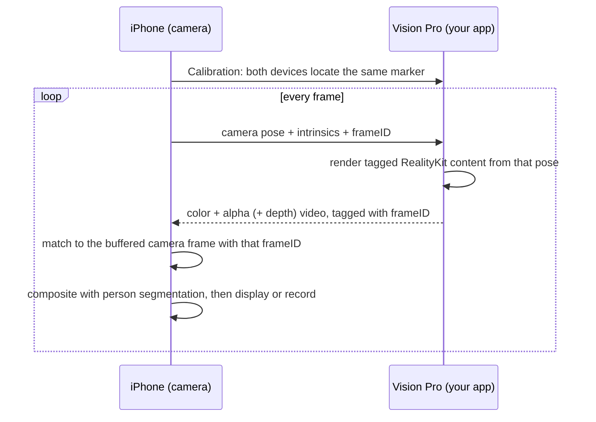

# Reality Mixer Pro: Spectator Mode for Apple Vision Pro

**Use an iPhone as a third-person camera for your visionOS app. Film the person wearing the headset together with the virtual content they see, composited live, as one video.**

> This is a community fork of [fabio914/RealityMixerVisionPro](https://github.com/fabio914/RealityMixerVisionPro) by Fabio Dela Antonio. The original prototype shows that the idea works. This fork turns it into a library that any RealityKit developer can use. All credit for the original idea and implementation goes to the original author. Improvements are offered back upstream wherever possible.

---

## The problem

Apple Vision Pro experiences are very hard to show to anyone who isn't wearing the headset.

- **Every built-in capture is first-person.** Mirror My View (AirPlay, up to 1080p), Record My View, High Quality capture (4K, 3 minutes), and Reality Composer Pro Developer Capture all record what the wearer sees. None of them show the wearer in the scene. That is the shot that sells a spatial app: a person surrounded by the content, seen from across the room.
- **Apple offers no third-person or spectator API.** There is no way to ask visionOS to render your scene from another camera. As of June 2026, an iPhone and a Vision Pro also cannot share a coordinate space ([Apple forums](https://developer.apple.com/forums/thread/831701)).
- **Building it yourself is hard.** You have two devices with separate tracking systems and clocks. You need to:
  - work out where the iPhone camera is in the headset's world;
  - render the scene a second time from that viewpoint on a device with a tight thermal budget;
  - move the frames over Wi-Fi;
  - line each one up with the right camera frame;
  - and composite the person correctly in front of or behind the virtual content.
- **Other platforms solved this, and their solutions faded.** HoloLens had *Spectator View*, which is now archived. Meta Quest had *Mixed Reality Capture*, which was handed to LIV in 2024 after most apps stopped supporting it. The lesson from both: if spectator mode costs every app ongoing work, developers drop it.

The result: Vision Pro trailers, demos, and store videos mostly rely on first-person footage or expensive post-production. Live demos at events show bystanders a mirrored first-person feed.

## The solution

1. **Calibrate once.** Both devices locate the same marker, which aligns the iPhone's ARKit world with the Vision Pro's world.
2. **The iPhone streams its camera pose** each frame. ARKit on the iPhone tracks it at 60 Hz.
3. **The Vision Pro app renders its 3D content from that pose** in an offscreen render, then streams the result back as video.
4. **The iPhone composites the result** with its live camera image. People-occlusion puts the wearer correctly in front of or behind the content. The iPhone then shows or records the final shot.

## What works well, and what doesn't

The best fit is an **immersive RealityKit app whose important content is 3D**: games, physics toys, drawing and art apps, visualizations. The bundled demos are exactly that.

| Content | Status |
|---|---|
| RealityKit entities in a Full Space / `ImmersiveSpace` | ✅ Supported |
| Unlit materials, `LowLevelMesh` | ✅ Supported (shown in the demos) |
| Lit PBR materials | ⚠️ Rendered with the image-based light you provide, not the room's real lighting |
| Particles, video materials, portals, ShaderGraph | 🔍 Not yet verified ([compatibility work](ROADMAP.md)) |
| Hand- or anchor-attached content | ⚠️ Needs extra work (anchors may not expose world transforms) |
| SwiftUI windows, volumes, RealityView attachments | ❌ Not capturable by any app (visionOS renders them out of process). Planned: re-draw panels on the iPhone from shared state ([design](docs/TDD.md#8-ui-panels-swiftui-windows--attachments)) |
| Shared Space (no immersive space open) | ❌ Requires ARKit world tracking, which needs a Full Space |
| Metal / CompositorServices apps | 🗺️ Planned (separate render pass) |

## Project status

The upstream code is an **early prototype**: it works for demos, but it is not ready for production apps. The [assessment](docs/ASSESSMENT.md) lists the bugs and limits found, with file and line references. This fork follows a public roadmap:

| Milestone | Theme | Highlights |
|---|---|---|
| **M0 Foundation** | Repo & tooling | CI, tests, Swift 6, docs |
| **M1 Reliable** (0.2) | It just connects | Bonjour discovery, QUIC transport, reconnection, no main-thread stalls, no live-entity reparenting |
| **M2 Looks Good** (0.3) | Shareable footage | HEVC with alpha, frame-matched compositing, better calibration, in-app recording |
| **M3 Easy** (0.4) | One-line adoption | `.mixedRealityCapture()` API, iPhone app on TestFlight/App Store, compatibility matrix |
| **M4 Beyond** (0.5+) | Broader coverage | UI panels, Metal apps, depth compositing, visionOS 27 `LowLevelRenderer` |

See the **[Roadmap](ROADMAP.md)** for epics and tasks.

## Documentation

| Document | What's inside |
|---|---|
| [PRD](docs/PRD.md) | Product requirements: users, use cases, goals, scope, success metrics |
| [TDD](docs/TDD.md) | Technical design: architecture, protocol, rendering, video, calibration, UI panels |
| [Roadmap](ROADMAP.md) | Milestones → epics → tasks with acceptance criteria |
| [Assessment](docs/ASSESSMENT.md) | Review of the current code: what works, bugs, performance, compatibility |
| [Research](docs/RESEARCH.md) | Findings from Apple docs, WWDC sessions, forums, and earlier spectator systems, with sources |
| [Original README](docs/ORIGINAL_README.md) | Upstream setup and integration guide (still matches the current code) |

## Try the current prototype

Requirements:
- An iPhone that supports Person Segmentation with Depth (A12 or later).
- A Vision Pro.
- Xcode 16 or later. This needs macOS 14.5+; the current Xcode needs a newer macOS.

1. Clone into a folder named `RealityMixerVisionPro`. The example projects reference the package by that path.
2. Build and run one of the [visionOS examples](VisionProExamples) on the Vision Pro, then build the [iPhone app](iPhoneProject) on the iPhone.
3. On the iPhone, enter the Vision Pro's IP address, tap **Connect**, and look at the iPhone's screen through the Vision Pro to calibrate. Then hide the calibration image.

The integration guide for your own app, with a code sample, is in the [original README](docs/ORIGINAL_README.md#how-to-add-support-to-your-visionos-app).

## Contributing

Contributions are welcome, especially device testing and the compatibility matrix. See [CONTRIBUTING.md](CONTRIBUTING.md). Pick a task from the [Roadmap](ROADMAP.md) and open an issue before starting large changes.

## Credits & license

- Original project: **[Reality Mixer Pro](https://github.com/fabio914/RealityMixerVisionPro)** by [Fabio Dela Antonio](https://github.com/fabio914). See also [Reality Mixer](https://github.com/fabio914/RealityMixer) for Meta Quest.
- Uses [SwiftSocket](https://github.com/swiftsocket/SwiftSocket) (to be replaced by Network.framework), VideoToolbox, ARKit, and RealityKit. The decoder is based on [zerdzhong's SwiftH264Demo](https://github.com/zerdzhong/SwfitH264Demo).
- `MiniBrush` uses code from Apple's [RealityKitDrawingApp](https://developer.apple.com/documentation/realitykit/creating-a-spatial-drawing-app-with-realitykit) sample.

Released under the [MIT License](LICENSE).
