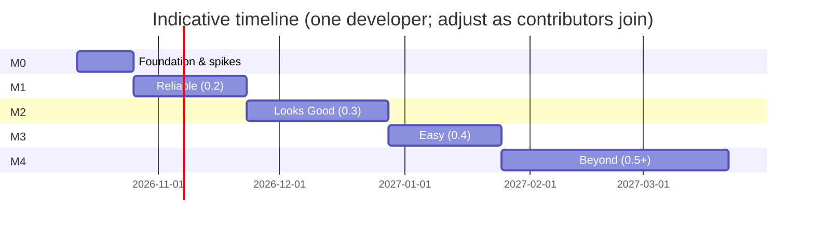

# Roadmap

How to read this:
- **Milestones** (M0–M4) are releases.
- **Epics** (E*m*.*n*) group related work.
- **Tasks** (T*m*.*n*.*k*) are pull-request-sized.
- **Size:** S ≈ ≤ 1 day · M ≈ 2–3 days · L ≈ 1 week.
- 🔗 marks related upstream issues in [fabio914/RealityMixerVisionPro](https://github.com/fabio914/RealityMixerVisionPro/issues).

Requirements (FR/NFR) are defined in the [PRD](docs/PRD.md) and designs in the [TDD](docs/TDD.md). Bug IDs (B*n*) refer to the [Assessment](docs/ASSESSMENT.md#4-bugs).

| Milestone | Version | Goal | Exit criteria |
|---|---|---|---|
| **M0 Foundation** | — | Tooling, upstream fixes, de-risking spikes | CI green; B1–B5 fixed; all ⚑ spikes have written results |
| **M1 Reliable** | 0.2.0 | It just connects and doesn't hurt the host app | Bonjour + pairing + reconnect ≤ 5 s; no blocking GPU waits on main; no live-entity reparenting; Swift 6; 30-min soak test passes |
| **M2 Looks Good** | 0.3.0 | Footage you'd post | HEVC+alpha; frame-matched composite with zero relative lag in recordings; calibration ≤ ~2 cm @ 2 m (target); in-app recording; adaptive quality |
| **M3 Easy** | 0.4.0 | One-line adoption | `.mixedRealityCapture()` API; iPhone app on TestFlight → App Store; compatibility matrix; docs; ≤ 10 min to first composite for new developers |
| **M4 Beyond** | 0.5.0+ | Broader coverage | UI panels, Metal apps, depth compositing, object-based calibration, external output |

---

## M0 Foundation

### E0.1 Repo, tooling, and CI
- [ ] **T0.1.1** Restructure the package: `Sources/MixedRealityCapture`, empty `MRCCore` + `MRCTransport` targets, `Examples/` folder with relative package paths (removes the "folder must be named RealityMixerVisionPro" requirement). *(M)*
- [ ] **T0.1.2** GitHub Actions: build the package for visionOS and iOS, and run `MRCCore` tests on macOS, on every PR. *(M)*
- [ ] **T0.1.3** swift-format config, PR/issue templates (bug, feature, device-test report), `CODEOWNERS`. *(S)*
- [ ] **T0.1.4** `docs/testing.md`: manual test checklist (calibration accuracy, 30-min soak, Wi-Fi changes). *(S)*
- [ ] **T0.1.5** Mirror this roadmap into GitHub milestones and epic issues. *(S)*

### E0.2 Upstream relations
- [ ] **T0.2.1** Open an upstream issue introducing the fork, the roadmap, and an offer to co-maintain. *(S)*
- [ ] **T0.2.2** Upstream PR: fix inverted keyframe detection (B1). *(S)*
- [ ] **T0.2.3** Upstream PR: replace the busy-loop reader with a blocking read on a background thread (B2). *(S)*
- [ ] **T0.2.4** Upstream PR: fix the calibration ordering check (B3) and set real PTS values (B5). *(S)*
- [ ] **T0.2.5** Upstream PR: use a `CVPixelBufferPool` instead of reusing one buffer (B4). *(S)*

### E0.3 Technical spikes (⚑ in the TDD), each producing a short write-up in `docs/spikes/`
- [ ] **T0.3.1** Measure main-thread and GPU cost of `RealityRenderer.updateAndRender` for the 3 demos at 720p/1080p × 30 fps, using RealityKit Trace. *(M)*
- [ ] **T0.3.2** Can the library run its own `ARKitSession` (world + image tracking) alongside the app's session? *(S)*
- [ ] **T0.3.3** Does VideoToolbox accept `HEVCWithAlpha` with `EnableLowLatencyRateControl` on Vision Pro? Measure encode latency. *(S)*
- [ ] **T0.3.4** Does `RealityRenderer` honour `ProjectiveTransformCameraComponent`? Is off-axis possible? *(S)*
- [ ] **T0.3.5** QUIC: one stream per frame vs. fragmented datagrams at 30/60 fps. Latency and overhead on real Wi-Fi. *(M)*
- [ ] **T0.3.6** Screen-to-lens offset: measure on 2–3 iPhone models; compare with Apple dimensional drawings. *(M)*
- [ ] **T0.3.7** Mirror scene: syncing skeletal animation and particle emitters to clones. *(M)*
- [ ] **T0.3.8** Anchored content: get world transforms for hand/plane anchors via `SpatialTrackingSession`. *(S)*

---

## M1 Reliable (0.2.0)

### E1.1 `MRCCore`: protocol and math (test-first)
- [ ] **T1.1.1** Port `Pose`/`Vector3`/`Quaternion` math to `simd`-only (drop the SceneKit dependency), with unit tests. *(S)*
- [ ] **T1.1.2** Message types (`Hello`, `Capabilities`, `SessionConfig`, `PoseUpdate`, `VideoFrameHeader`, `CalibrationSample/Result`, `Stats`) with binary Codable encoding. No raw `load(as:)` (fixes B7). *(M)*
- [ ] **T1.1.3** Protocol versioning: a major mismatch is rejected with a clear error; unknown minor fields are ignored. *(S)*
- [ ] **T1.1.4** Calibration solver: robust averaging and residuals, tested with synthetic noisy data. *(M)*

### E1.2 `MRCTransport`: discovery, pairing, reconnection 🔗 #4 #9
- [ ] **T1.2.1** `NetworkListener` (Vision Pro) advertising `_mrcspectator._udp` with a TXT record (app, device, protocol version, session). *(M)*
- [ ] **T1.2.2** `NetworkBrowser` (iPhone) with a live host list. *(S)*
- [ ] **T1.2.3** QUIC + TLS with a self-signed identity; 4-digit pairing code; trust on first use stored on the iPhone. *(L)*
- [ ] **T1.2.4** Channels: control stream (TLV), pose datagrams, one unidirectional stream per video frame. *(M)*
- [ ] **T1.2.5** Reconnection with backoff; the session and calibration survive reconnects (FR-3). *(M)*
- [ ] **T1.2.6** `NSLocalNetworkUsageDescription` / `NSBonjourServices` in examples and the app; document both. *(S)*
- [ ] **T1.2.7** Loopback integration tests on macOS: pairing, reconnect, simulated loss. *(M)*
- [ ] **T1.2.8** Remove the SwiftSocket dependency. *(S)*

### E1.3 Mirror scene (no reparenting)
- [ ] **T1.3.1** `SpectatorVisibleComponent` / `SpectatorHiddenComponent` (registered components). *(S)*
- [ ] **T1.3.2** Initial clone of tagged subtrees with a live→clone map; shared resources. *(M)*
- [ ] **T1.3.3** Per-frame sync in `SceneEvents.Update`: world transform, `isEnabled`, model/material changes, opacity. *(M)*
- [ ] **T1.3.4** Incremental structural updates (`DidAddEntity` / `WillRemoveEntity`). *(M)*
- [ ] **T1.3.5** Respect the tagged root's world transform (fixes the "parent must sit at the world origin" limitation). *(S)*
- [ ] **T1.3.6** Delete the reparenting code path; keep `referenceEntity` as a deprecated alias that tags its subtree. *(S)*

### E1.4 Async, zero-copy render and encode pipeline
- [ ] **T1.4.1** Replace `waitUntilCompleted` with `MTLSharedEvent` signalling via `actionsAfterRender`. *(M)*
- [ ] **T1.4.2** Render directly into `VTCompressionSession` pool buffers through `CVMetalTextureCache` (drop `getBytes`). *(M)*
- [ ] **T1.4.3** Encoder rewrite: AVCC samples plus out-of-band parameter sets, keyframe interval of 2 s plus forced keyframes, real PTS. *(M)*
- [ ] **T1.4.4** Latest-wins request scheduling: render only the newest `PoseUpdate`; cap in-flight frames at 2. *(S)*
- [ ] **T1.4.5** Drive rendering from the incoming pose, not a fixed `CADisplayLink`. *(S)*

### E1.5 Swift 6 strict concurrency 🔗 #8
- [ ] **T1.5.1** `SpectatorHost` actor; remove `@preconcurrency`, semaphores, and unsynchronized shared state (B6). *(M)*
- [ ] **T1.5.2** Enable strict concurrency in all targets; CI fails on new warnings. *(S)*

### E1.6 iPhone app: transport migration
- [ ] **T1.6.1** Replace IP entry with the discovery list + pairing screen (SwiftUI). *(M)*
- [ ] **T1.6.2** Connect asynchronously; no main-thread blocking (B9). *(S)*
- [ ] **T1.6.3** Reconnection UX: "Reconnecting…" overlay; keep calibration. *(S)*

### E1.7 Release 0.2.0
- [ ] **T1.7.1** 30-minute soak test on device; no leaks (Instruments) and no crashes. *(S)*
- [ ] **T1.7.2** Tag `0.2.0`, write the changelog, migration notes from the upstream API. *(S)*

---

## M2 Looks Good (0.3.0)

### E2.1 Video quality
- [ ] **T2.1.1** HEVC with alpha (premultiplied BGRA), `[FG | BG]` side-by-side layout, `TargetQualityForAlpha`. *(M)*
- [ ] **T2.1.2** Negotiate codecs through `Capabilities`; H.264 quadrant layout as fallback. *(S)*
- [ ] **T2.1.3** iPhone decoder for HEVC+alpha output (BGRA or planar alpha) with `frameID` pass-through. *(M)*
- [ ] **T2.1.4** Adaptive bitrate from client stats. *(M)*

### E2.2 Frame-matched compositing
- [ ] **T2.2.1** Ring buffer on the iPhone: copy `capturedImage`, matte, and depth into our own pools; never retain `ARFrame`s. *(M)*
- [ ] **T2.2.2** Frame matcher in `MRCCore` (out-of-order, drops, eviction), test-first. *(M)*
- [ ] **T2.2.3** Fall back to latest-wins after N missed matches; auto-size the buffer from measured RTT. *(S)*
- [ ] **T2.2.4** Stats overlay (debug): RTT, fps, drops, bitrate, buffer depth. *(S)*

### E2.3 Metal compositor (replaces SceneKit)
- [ ] **T2.3.1** Drive `ARSession` directly with `MTKView` presentation (no `ARSCNView`). *(M)*
- [ ] **T2.3.2** `ARMatteGenerator` matte + dilated depth. *(S)*
- [ ] **T2.3.3** Compute compositor: BG over camera, person over BG, premultiplied FG over all; crop/scale via `cropRect`; configurable alpha threshold. *(M)*
- [ ] **T2.3.4** Golden-image tests for the compositor. *(M)*

### E2.4 Calibration v2
- [ ] **T2.4.1** Guided flow with sample collection, a stillness check, and a progress ring. *(M)*
- [ ] **T2.4.2** Printed-marker mode (iPhone `ARImageAnchor` + Vision Pro `ImageAnchor`); printable PDF in the repo. *(M)*
- [ ] **T2.4.3** Per-model screen-to-lens table for the on-screen marker mode (from T0.3.6). *(M)*
- [ ] **T2.4.4** Quality readout (RMS residual) and a "Recalibrate" prompt when drift is detected. *(S)*
- [ ] **T2.4.5** visionOS 27: read anchors with `coordinateSpace(correction: .none)`. *(S)*
- [ ] **T2.4.6** Symmetric-FOV + crop projection so the render matches the iPhone's real intrinsics. *(S)*

### E2.5 Lighting 🔗 #7
- [ ] **T2.5.1** `lighting:` configuration accepting an `EnvironmentResource`; bundled neutral default IBL. *(S)*
- [ ] **T2.5.2** Document how to match the headset look (IBL, tone mapping on the 27 SDK). *(S)*

### E2.6 Recording
- [ ] **T2.6.1** `AVAssetWriter` HEVC recording of the composite to Photos (1080p60 / 4K30 camera formats). *(M)*
- [ ] **T2.6.2** Audio from the iPhone microphone (optional toggle). *(S)*

### E2.7 Adaptive quality & thermal
- [ ] **T2.7.1** Thermal-state policy (`.serious` → 720p/30, `.critical` → pause with notice). *(S)*
- [ ] **T2.7.2** Main-thread budget monitor that steps down resolution and then frame rate. *(M)*
- [ ] **T2.7.3** Validate NFR-1/NFR-2 on the demos; publish the numbers in `docs/performance.md`. *(M)*

---

## M3 Easy (0.4.0)

### E3.1 Public API
- [ ] **T3.1.1** `.mixedRealityCapture(enabled:configuration:)` SwiftUI modifier for `RealityView`. *(M)*
- [ ] **T3.1.2** `SpectatorSession` observable state (advertising / paired / calibrating / streaming / error). *(S)*
- [ ] **T3.1.3** Option to supply the app's own ARKit providers (from T0.3.2). *(S)*
- [ ] **T3.1.4** Deprecate `MixedRealityCaptureManager` with a migration guide. *(S)*
- [ ] **T3.1.5** Update all three examples to the ≤ 10-line integration. *(S)*

### E3.2 iPhone app as a product 🔗 #5
- [ ] **T3.2.1** SwiftUI redesign: onboarding, host list, calibration, live view, controls (record, layers, quality, delay). *(L)*
- [ ] **T3.2.2** Layered recording (camera / virtual RGBA / matte) to Files (FR-13). *(M)*
- [ ] **T3.2.3** Settings: quality presets, alpha threshold, manual delay override, peer-to-peer toggle. *(S)*
- [ ] **T3.2.4** App Store preparation: name/branding (see PRD open question), privacy labels, screenshots, review notes. *(M)*
- [ ] **T3.2.5** TestFlight public beta, then App Store release (FR-11). *(M)*

### E3.3 Wearer controls
- [ ] **T3.3.1** Spectator indicator + stop control on the Vision Pro (FR-12). *(S)*
- [ ] **T3.3.2** Pairing-code presentation in the headset. *(S)*

### E3.4 Compatibility Lab
- [ ] **T3.4.1** `Examples/CompatLab`: a scene per feature (PBR, ShaderGraph, particles, video material, LowLevelMesh, portals, skinned animation, transparency, additive blending). *(M)*
- [ ] **T3.4.2** Capture side-by-side (headset vs spectator) screenshots and publish the matrix in `docs/compatibility.md`. *(M)*

### E3.5 Documentation
- [ ] **T3.5.1** DocC for all public API. *(M)*
- [ ] **T3.5.2** "Hello Spectator" sample (≈ 50 lines) and a getting-started guide. *(S)*
- [ ] **T3.5.3** Troubleshooting: local network permission, Wi-Fi band and channel, firewalls, calibration tips. *(S)*
- [ ] **T3.5.4** Short tutorial video. *(M)*

### E3.6 Release engineering
- [ ] **T3.6.1** SemVer policy, `CHANGELOG.md`, release workflow. *(S)*
- [ ] **T3.6.2** Swift Package Index listing. *(S)*
- [ ] **T3.6.3** Protocol compatibility tests (app N vs. client N−1). *(S)*

### E3.7 Launch
- [ ] **T3.7.1** Usability test with 3 external developers (time to first composite ≤ 10 min). *(M)*
- [ ] **T3.7.2** Demo video and launch posts (Apple Developer Forums, r/visionosdev, social). *(S)*

---

## M4 Beyond (0.5.0+)

### E4.1 UI panels (FR-14)
- [ ] **T4.1.1** `.spectatorPanel(id:state:)` modifier reporting pose (`onGeometryChange3D` + `.immersiveSpace` / `.worldReference`), size, scale, and state. *(L)*
- [ ] **T4.1.2** Attachment-entity tagging with per-frame pose. *(M)*
- [ ] **T4.1.3** iPhone panel renderer: shared SwiftUI view → `ImageRenderer` → projected quad using the matched frame's pose; glass approximated by blurring the camera image. *(L)*
- [ ] **T4.1.4** Fallback: headset-side `ImageRenderer` snapshots as textures. *(M)*
- [ ] **T4.1.5** Never report `contentCaptureProtected` views. *(S)*

### E4.2 Metal / CompositorServices (FR-15)
- [ ] **T4.2.1** `MetalSpectatorSource` with an app-supplied draw closure (view/projection matrices, colour + depth targets). *(M)*
- [ ] **T4.2.2** Example: a minimal CompositorServices app with spectator support. *(M)*

### E4.3 Depth compositing (FR-16)
- [ ] **T4.3.1** visionOS 27 `LowLevelRenderer` source with mesh-instance mirroring, depth output, off-axis projection. *(L)*
- [ ] **T4.3.2** Depth stream (10-bit HEVC luma or LZ4 at low resolution). *(M)*
- [ ] **T4.3.3** Per-pixel compositor using person depth and LiDAR `sceneDepth`, with soft edges. *(L)*

### E4.4 Object-based calibration (FR-18)
- [ ] **T4.4.1** iOS 27 / visionOS 27 reference-object calibration with a 3D-printable calibration object. *(L)*

### E4.5 Output
- [ ] **T4.5.1** External display / AirPlay output from the iPhone app (FR-17). *(M)*
- [ ] **T4.5.2** Mac receiver app for OBS workflows (exploration). *(L)*

### Backlog / exploration
- Multiple spectator cameras at once.
- Full-body mode for the iPhone client 🔗 #6.
- State-sync rendering on the iPhone for simple scenes (HoloLens Spectator View approach); see [TDD §16](docs/TDD.md#16-alternatives-considered).
- Professional camera rig support (external camera + iPhone as tracker).

---

## Upstream issue mapping

| Upstream issue | Covered by |
|---|---|
| [#4](https://github.com/fabio914/RealityMixerVisionPro/issues/4) Reconnections | E1.2 (T1.2.5) |
| [#5](https://github.com/fabio914/RealityMixerVisionPro/issues/5) iOS client UI | E1.6, E3.2 |
| [#6](https://github.com/fabio914/RealityMixerVisionPro/issues/6) Full-body tracking mode | Backlog |
| [#7](https://github.com/fabio914/RealityMixerVisionPro/issues/7) Lights | E2.5 |
| [#8](https://github.com/fabio914/RealityMixerVisionPro/issues/8) Swift 6 | E1.5 |
| [#9](https://github.com/fabio914/RealityMixerVisionPro/issues/9) Bonjour discovery | E1.2 (T1.2.1–T1.2.2) |
