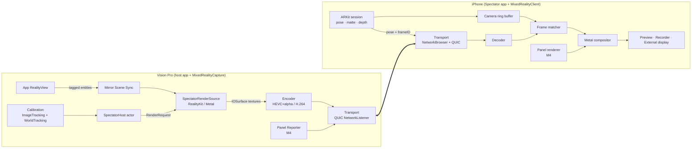

# TDD: Technical Design Document

| | |
|---|---|
| **Status** | Draft v0.1, for review |
| **Last updated** | 2026-10-09 |
| **Related** | [PRD](PRD.md) · [Roadmap](../ROADMAP.md) · [Assessment](ASSESSMENT.md) · [Research](RESEARCH.md) |

Items marked **⚑ Spike** are assumptions that need a short on-device experiment before the design is final. They are tracked as tasks in the [Roadmap](../ROADMAP.md).

---

## 1. Goals

Technical goals derived from the [PRD](PRD.md):

1. Render developer-tagged RealityKit content from the iPhone camera's pose **without touching the app's live entities**.
2. Match each rendered frame to the exact iPhone camera frame it was rendered for, so the composite has no relative lag.
3. Keep the Vision Pro host app's main thread and GPU budget almost unaffected, with adaptive quality.
4. Make the transport secure, discoverable, and self-healing.
5. Design the render source as a protocol, so Metal apps (and, later, UI panels and depth) fit without redesign.

## 2. Current architecture (upstream prototype)

```
visionOS app                                     iPhone app
─────────────                                    ──────────
CADisplayLink (main, 30 Hz)                      ARSCNView + ARKit (personSegmentationWithDepth)
 ├─ queryDeviceAnchor                            ├─ sends camera pose + FOV each ARFrame (TCP)
 ├─ move referenceEntity.children → RealityRenderer
 ├─ render FG (near→headset) + BG (headset→far)  ├─ decodes H.264 (VideoToolbox)
 ├─ 4× command buffers, waitUntilCompleted       ├─ SceneKit planes with shader modifiers
 ├─ GPU→CPU getBytes into one CVPixelBuffer      │   (FG at 0.01 m, BG at 100 m, person in between)
 ├─ H.264 encode (2W×2H quadrant layout)         └─ display only (no recording)
 └─ TCP server :13370 (SwiftSocket), busy-loop reader
```

The main problems are covered in the [Assessment](ASSESSMENT.md): main-thread GPU waits, reparenting live entities, an inverted keyframe check, a busy-loop network thread, no frame matching, manual IP entry, and no reconnection.

## 3. Target architecture



### 3.1 Package layout

A single Swift package with several products:

| Target | Platforms | Responsibility |
|---|---|---|
| `MRCCore` | iOS, visionOS, macOS | Protocol messages and coding, math (`Pose`, intrinsics, projection), frame-matching logic, versioning. **Pure, fully unit-tested.** |
| `MRCTransport` | iOS, visionOS, macOS | Network.framework wrappers: listener/browser, pairing, QUIC streams, reconnection |
| `MixedRealityCapture` | visionOS | Host: session, calibration, render sources, encoder, adaptive quality, SwiftUI modifier |
| `MixedRealityCaptureMetal` | visionOS | Helpers for CompositorServices apps (M4) |
| `MixedRealityClient` | iOS | Client: ARKit capture, ring buffer, decoder, compositor, recorder |
| `MixedRealityPanels` | iOS, visionOS | UI-panel descriptors and iPhone-side renderer (M4) |

The iPhone app (`Apps/Spectator`) becomes a thin SwiftUI shell over `MixedRealityClient`. The examples move to `Examples/`, which reference the package by relative path. That removes the "folder must be named RealityMixerVisionPro" requirement.

### 3.2 Platform floor

Proposed: **visionOS 26 / iOS 26**. These versions add `NetworkConnection`/`NetworkListener`/`NetworkBrowser`, `coordinateSpace3D`, and `ViewAttachmentComponent(rootView:)`. Features from visionOS 27 / iOS 27 sit behind `if #available` checks:
- `LowLevelRenderer`;
- `coordinateSpace(correction: .none)`;
- ARKit object tracking on iOS.

*(Open question in the [PRD](PRD.md#11-open-questions).)*

## 4. Coordinate systems and calibration

### 4.1 Frames

| Symbol | Meaning |
|---|---|
| `W_v` | Vision Pro world (ARKit / immersive-space origin) |
| `W_p` | iPhone ARKit world |
| `C_p(t)` | iPhone camera pose in `W_p` at frame time *t* (from `ARFrame.camera.transform`) |
| `M_v` | Marker pose in `W_v` (from `ImageAnchor`) |
| `M_p` | Marker pose in `W_p` |
| `T` | Calibration transform `W_p → W_v` |

The camera pose used for rendering is `C_v(t) = T · C_p(t)`.

### 4.2 Calibration methods

**A. On-screen marker (current, kept for convenience).** The iPhone shows the marker. The marker's pose is the iPhone screen's pose: `M_p = C_p(t) · S_model`, where `S_model` is the fixed screen-to-camera transform for that iPhone model. The current code assumes `S_model` is a pure −90° rotation about X with no translation; the real lens offset is several centimetres.
- Ship a per-model `S_model` table built from Apple's published dimensional drawings.
- Allow refinement by solving hand-eye calibration (`AX = XB`) from several poses. **⚑ Spike**
- The phone must be held still while sampling, because visionOS image anchors update at about 1 Hz.

**B. Printed marker (new, recommended for quality).** A printed marker sits in view of both devices. The iPhone detects it as an `ARImageAnchor` (giving `M_p`) and the Vision Pro as an `ImageAnchor` (giving `M_v`). This removes `S_model` entirely and works with the phone on a tripod.

**C. Reference object (M4, iOS 27 / visionOS 27).** The same `.referenceobject` file is tracked by `ARObjectAnchor` on the iPhone and `ObjectAnchor` on the Vision Pro. A 3D-printed calibration object can work this way.

In all cases: `T = M_v · M_p⁻¹`.

### 4.3 Robust estimation

- Collect N ≥ 10 pairs `(M_v, M_p)` that were captured at the same time. Pair them by host timestamp ± 50 ms, after the iPhone has been still for at least 0.5 s according to ARKit.
- Average translations with a trimmed mean. Average rotations with a sign-aligned quaternion mean, or the eigenvector method. Reject samples more than 2σ from the mean.
- Report residual error (RMS position/rotation) as the calibration quality shown in the UI.
- On visionOS 27, read anchor poses with `coordinateSpace(correction: .none)` for metric accuracy.
- Persist `T` for the session and keep it across reconnects. Offer recalibration when the residual grows. Drift can be detected by re-observing the marker.

## 5. Protocol

### 5.1 Transport

- **Network.framework**:
  - `NetworkListener` on the Vision Pro, advertising Bonjour `_mrcspectator._udp` with a TXT record holding app name, device name, protocol version, and session ID.
  - `NetworkBrowser` on the iPhone.
  - Modelled on Apple's [Connecting iPadOS and visionOS apps over the local network](https://developer.apple.com/documentation/visionos/connecting-ipados-and-visionos-apps-over-the-local-network) sample.
- **QUIC** with TLS:
  - The Vision Pro generates a self-signed identity per install.
  - Pairing uses a 4-digit code shown in the headset, derived into a PSK or verified over the channel (**⚑ Spike**: pick the simplest secure option that Network.framework supports).
  - The iPhone stores trust on first use.
- `peerToPeerIncluded` is **off** by default. AWDL causes periodic 30–50 ms stalls; it is an opt-in setting.
- Info.plist on both apps: `NSLocalNetworkUsageDescription`, `NSBonjourServices`.

### 5.2 Channels

| Channel | QUIC mapping | Direction | Content |
|---|---|---|---|
| Control | bidirectional stream 0 (reliable, TLV framed) | ↔ | Hello/version, pairing, capabilities, config, calibration commands, stats, panel descriptors (M4) |
| Pose | datagrams (fallback: stream) | iPhone → VP | `PoseUpdate` per ARFrame used for rendering (30–60 Hz) |
| Video | one unidirectional stream per frame | VP → iPhone | `VideoFrame` header + encoded access unit(s) |

A new stream per frame means a lost or slow frame never blocks the next one. The sender cancels streams older than the newest keyframe dependency if the queue grows (**⚑ Spike**: confirm stream setup overhead at 30–60 Hz).

### 5.3 Messages (`MRCCore`)

All messages carry `protocolVersion: UInt16`. Encoding is a compact binary `Codable` (not raw `MemoryLayout` structs). The major version must match; unknown fields from a newer minor version are ignored.

```swift
struct Hello { var protocolVersion: UInt16; var role: Role; var deviceName: String; var capabilities: Capabilities }
struct Capabilities { var codecs: [Codec]; var maxResolution: Size; var maxFPS: Int; var supportsDepth: Bool; var supportsPanels: Bool }
struct SessionConfig { var codec: Codec; var layerLayout: LayerLayout; var renderSize: Size; var fps: Int; var bitrate: Int; var cropRect: Rect }

struct PoseUpdate {
    var frameID: UInt64               // monotonically increasing per iPhone session
    var captureTime: Double           // iPhone uptime (ARFrame.timestamp), for stats only
    var cameraInPhoneWorld: Pose      // C_p(t)
    var intrinsics: Intrinsics        // fx, fy, cx, cy (scaled to render size), sent every frame
    var imageSize: Size
}

struct VideoFrameHeader {
    var frameID: UInt64               // echoes PoseUpdate.frameID
    var isKeyframe: Bool
    var layerLayout: LayerLayout      // .fgBgSideBySideWithAlpha | .quadrantH264 | ...
    var splitDistance: Float          // FG/BG split used (metres), for diagnostics
    var hostRenderTime: Double        // VP uptime, for stats
}

struct CalibrationSample { var markerInPhoneWorld: Pose; var phoneStill: Bool; var time: Double }
struct CalibrationResult { var transform: Pose; var rmsPosition: Float; var rmsRotationDeg: Float; var sampleCount: Int }
```

## 6. Frame lifecycle and synchronization

```
iPhone                                         Vision Pro
──────                                         ──────────
ARFrame #n ──copy image/matte/depth──► ring buffer[n]
PoseUpdate(n) ───────────────────────────────► latest-request slot (older requests dropped)
                                                render at T·C_p(n) → encode → VideoFrame(n)
VideoFrame(n) ◄───────────────────────────────
decode → match ring buffer[n] → composite → present / record
```

- **Frame ID echo, no clock sync needed.** The Vision Pro renders the newest pose request and drops older ones (latest wins), so its frame rate adapts to its budget. Every output frame carries the `frameID` it was rendered for.
- **Ring buffer on the iPhone.** Keep about 300 ms of frames: 18 at 60 fps, or about 9 at 30 fps.
  - Copy `capturedImage` (and the matte/depth) into our own `CVPixelBufferPool`. **Never retain `ARFrame`s**, because ARKit stalls when frames are held.
  - If a frame ID has been evicted, drop the video frame and increase the buffer.
- **Preview** shows the newest *matched* composite. Its latency equals the round-trip time plus encode, decode and render (target ≤ 250 ms). Recordings have zero relative lag by construction.
- **Stats** are sent back on the control stream every second: round trip from `captureTime`, decode time, drops, and bitrate. They feed adaptive quality (§10).
- **Fallback:** if the client misses N consecutive matches, it switches to "latest wins" compositing. That is the current behaviour: it lags but always shows something.

## 7. Rendering on the Vision Pro

### 7.1 Render source abstraction

```swift
public struct SpectatorRenderRequest: Sendable {
    public let frameID: UInt64
    public let cameraTransform: simd_float4x4   // C_v in Vision Pro world
    public let projection: SpectatorProjection   // symmetric FOV + crop, or full intrinsics
    public let size: SIMD2<Int>
    public let splitDistance: Float?             // FG/BG layering (M2); nil when depth is used
}

public struct SpectatorRenderTargets {
    public let color: MTLTexture                 // premultiplied BGRA, IOSurface-backed (from the encoder pool)
    public let depth: MTLTexture?                // R16F/R32F linear metres (M4)
}

@MainActor
public protocol SpectatorRenderSource: AnyObject {
    func render(_ request: SpectatorRenderRequest,
                into targets: SpectatorRenderTargets,
                completion: @escaping @Sendable () -> Void) throws
}
```

Built-in implementations:
- `RealityKitSpectatorSource` (M1);
- `MetalSpectatorSource` (M4: calls an app-supplied draw closure with view and projection matrices);
- `LowLevelRendererSpectatorSource` (M4, visionOS 27).

### 7.2 RealityKit: mirror scene, never reparent live entities

Today's code moves the app's live entities into `RealityRenderer` and back every frame. This interferes with physics, input, and anchoring, and forces render-server re-commits. Apple's support engineers recommend cloning instead ([thread 773957](https://developer.apple.com/forums/thread/773957)).

1. **Tagging.** `SpectatorVisibleComponent` marks a subtree root. `SpectatorHiddenComponent` excludes descendants, such as debug gizmos or private HUDs.
2. **Initial mirror.** `clone(recursive: true)` each tagged subtree into the `RealityRenderer`'s scene, and keep a `[ObjectIdentifier: Entity]` map from live entity to clone. Meshes, materials, `LowLevelMesh` and `LowLevelTexture` are shared by reference, so no copies are made.
3. **Per-frame sync** (subscribe to `SceneEvents.Update` in the app's scene):
   - copy `transform` and `isEnabled` for live entities whose transform changed (track a hash or a dirty flag);
   - copy `ModelComponent` when the mesh or material reference changed;
   - copy `OpacityComponent`;
   - copy animation playback time for entities with `AnimationPlaybackController`s (**⚑ Spike**).
4. **Structural changes** (`SceneEvents.DidAddEntity` / `WillRemoveEntity` under tagged roots) add or remove clones incrementally.
5. **World-space correctness.** The mirror root gets the tagged root's *world* transform (`transformMatrix(relativeTo: nil)`), so content under anchors or offset parents renders in the right place. This fixes a current limitation.
6. **Known limitations to document:** custom `System`s don't run on clones; mirror the *results* instead. Hand and anchor entities without readable transforms need `SpatialTrackingSession` (**⚑ Spike**). Particle-emitter state isn't synchronized; emitters re-simulate on their own.

### 7.3 RealityRenderer configuration

- `cameraSettings.colorBackground = .color(clear)`.
- `antialiasing = .multisample4X`.
- `lighting.resource` is the developer-provided `EnvironmentResource`, with a neutral default IBL bundled in the package.
- `activeCamera` is a `PerspectiveCamera`.
- **Projection:** `RealityRenderer` only supports symmetric frustums, but the iPhone's principal point is off-centre. So render with a symmetric vertical FOV large enough to contain the real frustum, and send `cropRect` in `SessionConfig`. The iPhone crops and scales during compositing. (`ProjectiveTransformCameraComponent` is also limited to symmetric matrices.)
- **FG/BG layering (M2):** two `updateAndRender` passes with near/far split at the distance of the headset along the camera's forward axis. This is the current approach, made async.
- **Async:** each pass signals an `MTLSharedEvent` via `actionsAfterRender`. The encode step waits on the event in a command buffer or a completion handler, **never with `waitUntilCompleted` on the main actor**.
- **Measure:** `updateAndRender` is `@MainActor`, so its CPU encoding cost counts against the app's main thread. Profile it with RealityKit Trace. **⚑ Spike**: per-frame main-thread cost for the demo scenes at 720p/1080p, at 30 fps.

### 7.4 Depth (M4)

`RealityRenderer` has no depth output. The options, in order of preference:

1. **visionOS 27 `LowLevelRenderer`.** Provides a depth attachment, off-axis projection (`.perspective(leftTangent:…)` or `.custom(matrix:)`), and ShaderGraph materials. The cost is mirroring meshes into `LowLevelMeshInstance` arrays instead of entities.
2. **Second pass with a depth-encoding unlit material** on the clones (doubles the render cost).
3. **Metal apps:** the app writes depth directly.

Depth replaces the FG/BG split when available, enabling true per-pixel occlusion (§9).

## 8. UI panels (SwiftUI windows & attachments)

No visionOS API returns system-rendered UI pixels from another viewpoint. Panels are therefore **described as data and re-drawn on the iPhone**. Full design in M4; the summary:

- **Vision Pro side.** A `.spectatorPanel(id:state:)` view modifier and an attachment-entity tag report each panel's:
  - **pose:** `onGeometryChange3D` with `transform(in: .immersiveSpace)` (visionOS 2+), or `coordinateSpace3D()` → `.worldReference` (visionOS 26+); for attachments, `ViewAttachmentEntity.transformMatrix(relativeTo: nil)`;
  - **physical size**, including dynamic world scaling;
  - **a `Codable` state payload**.

  Messages go on the control stream only when they change.
- **iPhone side.** The same SwiftUI view type (from a package shared by the app and its spectator plug-in) is rendered with `ImageRenderer` into a texture. The texture is projected as a quad, using the *matched* frame's camera pose so it stays locked with the 3D content.
  - Glass is approximated by blurring the camera image behind the quad.
- **Fallback.** An `ImageRenderer` snapshot made on the Vision Pro and sent as a compressed texture. It has known gaps: Map, WebView, video, UIKit-backed views, and flattened materials.
- **Protected content.** Views marked `contentCaptureProtected` are never reported.

## 9. Video pipeline

### 9.1 Encoder (Vision Pro)

| Setting | Value |
|---|---|
| Codec | `kCMVideoCodecType_HEVCWithAlpha` (premultiplied BGRA input), fallback `H.264` with alpha in separate quadrants (today's layout) |
| Layout (M2) | `[FG | BG]` side by side (2W × H), alpha carried in the HEVC auxiliary layer, which halves pixel area compared with today's 2W × 2H quadrants |
| Buffers | `VTCompressionSessionGetPixelBufferPool` → `CVMetalTextureCache` textures; render directly into encoder buffers (**zero-copy**, no `getBytes`) |
| Rate control | `kVTVideoEncoderSpecification_EnableLowLatencyRateControl` when it is accepted together with alpha (**⚑ Spike**), otherwise `RealTime = true`, `AllowFrameReordering = false`, `MaxFrameDelayCount = 1`, `PrioritizeEncodingSpeedOverQuality = true` |
| Bitrate | Starts at 8 Mbps at 1080p30 and adapts (§10); `TargetQualityForAlpha ≈ 0.85` |
| Keyframes | `MaxKeyFrameIntervalDuration = 2 s`, plus a forced keyframe on client request (after loss or a new connection) |
| Presets | iOS/visionOS 26 `kVTCompressionPreset_VideoConferencing` evaluated as a baseline |
| Timestamps | PTS = frame index / fps (the current code always passes 0) |
| Bitstream | Send AVCC/HVCC samples plus parameter sets out of band on the control stream at every keyframe, which avoids the inverted Annex-B conversion |

### 9.2 Depth stream (M4)

Inverse depth, normalised to [near, far] (default 0.25–8 m), in either form:
- 10-bit luma of a separate HEVC Main10 low-latency stream at half resolution; or
- **lossless LZ4** at 256×192, which matches the iPhone's depth resolution.

A 3×3 min/median filter is applied after decoding.

### 9.3 Decoder (iPhone)

`VTDecompressionSession` output to IOSurface-backed BGRA (or 4:2:0 + alpha planes, sampled directly in the compositor). Asynchronous decode, `frameID` passed through as `sourceFrameRefCon`.

## 10. Adaptive quality and performance budget

| Signal | Action |
|---|---|
| `ProcessInfo.thermalState` `.fair` | Hold |
| `.serious` | 1080p → 720p, 60 → 30 fps |
| `.critical` | Pause spectator rendering; show a notice on the iPhone |
| Host main-thread spectator cost > budget (rolling) | Lower render size, then frame rate |
| Network RTT or loss rising (client stats) | Lower bitrate, then resolution; increase the ring buffer |

Initial budget targets, to be validated in the M0 spike: main-thread time for spectator work ≤ 3 ms per spectator frame (≈ 1 ms per 90 Hz display frame at 30 fps), and GPU ≤ 2 ms per spectator frame at 1080p for the demo scenes.

## 11. iPhone client

- **ARKit:**
  - `ARWorldTrackingConfiguration`, `frameSemantics = [.personSegmentationWithDepth]`, plus `.sceneDepth` on LiDAR devices.
  - Video format: `recommendedVideoFormatFor4KResolution` when recording in 4K, otherwise 1080p60.
  - Rendering is driven with ARKit's `ARSession` directly, **without** `ARSCNView`. The compositor owns presentation through `MTKView`/`CAMetalLayer`.
- **Matte & depth:** `ARMatteGenerator(device:matteResolution: .half)` provides `generateMatte` and `generateDilatedDepth`. On LiDAR devices, `sceneDepth` is used for non-person occlusion (optional).
- **Compositor:** a Metal compute pass, one per output frame:
  - `out = camera·(1 − bg.a) + bg.rgb` (premultiplied virtual background over camera)
  - `out = lerp(out, camera, personMatte)` where the person is in front of BG (FG/BG mode)
  - `out = out·(1 − fg.a) + fg.rgb` (premultiplied FG over everything)
  - Depth mode (M4): per pixel, compare virtual depth with person or scene depth, using soft edges from the matte.
  - Crop and scale using `cropRect`, and apply the light edge treatment from a 0.25 alpha threshold (configurable).
- **Recorder:** `AVAssetWriter`, HEVC, composite track. Optional layered recording: camera, virtual RGBA (ProRes 4444 or HEVC+alpha), and matte. Saves to Photos or Files.
- **Output:** an external display via `UIScreen`/AirPlay scene (P2).

## 12. Concurrency model (Swift 6)

| Component | Isolation |
|---|---|
| `SpectatorHost` (session state machine) | `actor` |
| Mirror sync, `RealityRenderer`, ARKit providers bridging | `@MainActor` (RealityKit requirement) |
| Encoder / decoder callbacks | VideoToolbox queues, which hop into actors with `Sendable` payloads (IOSurface-backed buffers) |
| Transport | `NetworkConnection` async sequences inside the transport actor |
| Client compositor | Dedicated render thread / `MTKView` delegate; ring buffer protected by an actor or lock-free single-producer queue |

No `@preconcurrency` escapes, and no `DispatchSemaphore` around shared `Data`.

## 13. Security & privacy

- **Off by default.** The developer enables it explicitly, and the recommended pattern is to restrict it to demo or debug builds.
- Pairing is required before any pose is accepted or any frame is sent. All traffic is TLS (QUIC).
- Only explicitly tagged content is rendered. `contentCaptureProtected` UI is never reported.
- The wearer sees a spectator indicator and can stop the session at any time (FR-12).
- No analytics. Stats stay on the local link.

## 14. Test strategy

| Level | What | How |
|---|---|---|
| Unit | `Pose` math, calibration solver (synthetic noisy samples → known `T`), projection and crop math, message coding round-trips and version handling, frame matcher (out-of-order, drops, eviction) | Swift Testing, `MRCCore` on macOS in CI |
| Integration | Host ↔ client over loopback QUIC on macOS: pairing, reconnection, stream cancellation under simulated loss | Test harness with a fake render source and fake ARKit pose feed |
| Golden image | Compositor shader: fixed camera, matte and virtual inputs → reference output (per-pixel tolerance) | Metal on macOS / iOS simulator |
| Performance | Main-thread and GPU cost per spectator frame, dropped host frames, thermal over 30 min | On device: RealityKit Trace, Metal System Trace, Xcode thermal inducers |
| Compatibility | Matrix of RealityKit features (PBR, ShaderGraph, particles, video, LowLevelMesh, portals, skinned animation) | Example "Compat Lab" app; screenshots stored in `docs/compat/` |
| Manual | Calibration accuracy (ruler/marker grid), 30-minute session, Wi-Fi channel changes | Checklist in `docs/testing.md` (M1) |

New logic in `MRCCore` and `MRCTransport` is test-first: tests are written alongside or before the implementation, and CI blocks merges on failures.

## 15. Migration from the prototype

1. Fix the critical bugs in place (keyframe flag, busy loop, calibration check, PTS) as small upstream-friendly PRs. See [Assessment §4](ASSESSMENT.md#4-bugs).
2. Introduce `MRCCore` with tests. Port the math and the payloads.
3. Replace SwiftSocket with `MRCTransport`, keeping the protocol v1 layout behind a compatibility flag for one release.
4. Replace reparenting with the mirror scene; make the pipeline async and zero-copy.
5. Rewrite the iPhone app in SwiftUI on top of `MixedRealityClient`.
6. Introduce the one-line API; keep `MixedRealityCaptureManager` as a deprecated shim for one release.

## 16. Alternatives considered

| Alternative | Why not (now) |
|---|---|
| **State sync + render on iPhone** (HoloLens Spectator View) | No camera-motion latency and no headset render cost. But every component and asset must be replicated, iOS RealityKit lacks attachments, and custom systems and shaders drift. Revisit for simple scenes later. |
| **Composite on the Vision Pro** (send camera feed to headset) | Doubles bandwidth, adds 4K decode on the thermally constrained device, and needs a second stream back out. |
| **Mac relay / `RemoteImmersiveSpace`** | Full/progressive immersion only (no passthrough, no RealityKit); a single headset; no data channel. |
| **Enterprise passthrough screen-capture broadcast** | First-person only, needs an enterprise license, reported fragile on visionOS 26. |
| **System capture (Mirror My View / Record My View)** | First-person only; a useful second angle in editing, not a replacement. |

## 17. Open technical questions

1. Can multiple `ARKitSession`s coexist with the app's own, or should the library accept the app's providers? (**⚑ Spike**; the API should allow both.)
2. Does low-latency rate control accept `HEVCWithAlpha`? (**⚑ Spike**)
3. Do `RealityRenderer` passes honour `ProjectiveTransformCameraComponent` on clones? (**⚑ Spike**)
4. Which RealityKit features render identically in `RealityRenderer`? (Compat Lab, M3)
5. What does QUIC stream-per-frame cost at 60 fps, compared with datagram fragmentation? (**⚑ Spike**)
